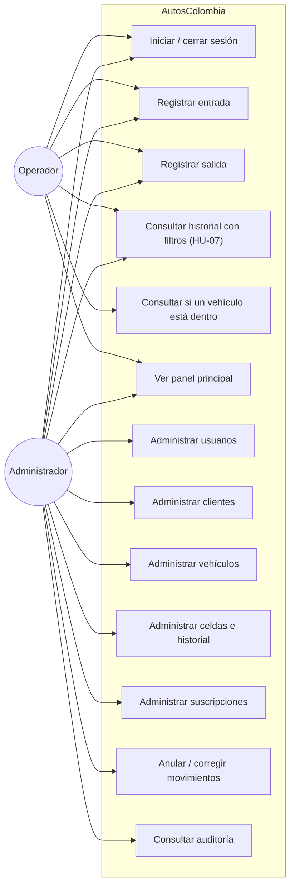
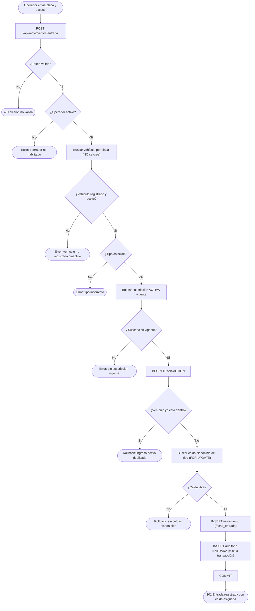
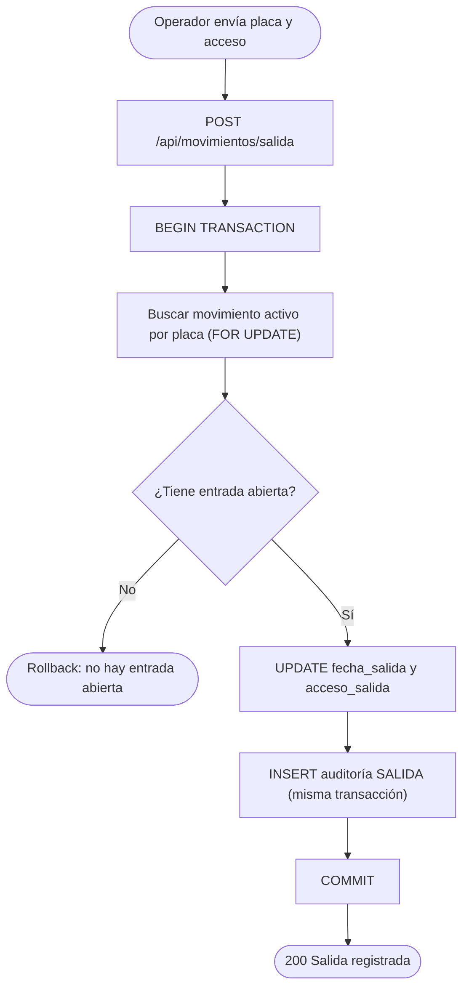
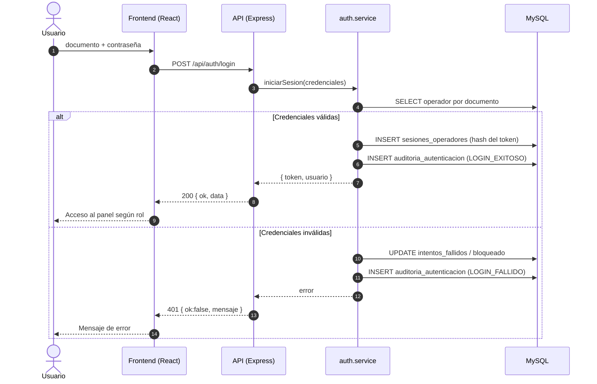
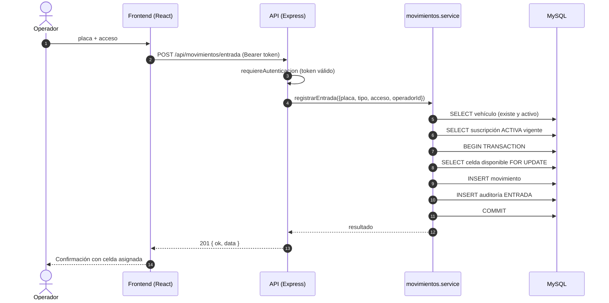

# Diagramas — Iteración 2

Los diagramas se entregan en **Mermaid** (texto), por lo que se renderizan en GitHub/VS Code y pueden exportarse a imagen.
Reflejan únicamente las funciones implementadas y los endpoints reales.

---

## 1. Diagrama de casos de uso

---

## 2. Diagrama de actividades — Registrar entrada

---

## 3. Diagrama de actividades — Registrar salida

---

## 4. Diagrama de secuencia — Inicio de sesión

---

## 5. Diagrama de secuencia — Registrar entrada (con auditoría transaccional)

> Si cualquiera de los pasos dentro de la transacción falla, se ejecuta `ROLLBACK`: no se crea el movimiento ni el evento de auditoría.
