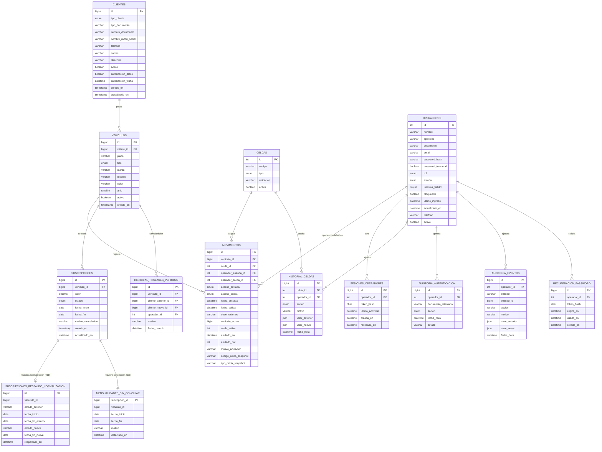

# Modelo entidad-relación — AutosColombia

Modelo construido a partir de la **estructura real de la base de datos** (`autoscolombia`, MySQL 8) verificada el 2026-11-13, coherente con `backend/sql/schema.sql` y las migraciones `002` a `011` (orden de ejecución en [`07_Orden_Migraciones.md`](07_Orden_Migraciones.md)).

## 1. Diagrama entidad-relación

## 2. Descripción de las relaciones

| Relación | Cardinalidad | Integridad |
|---|---|---|
| Cliente → Vehículos | 1 : N | `vehiculos.cliente_id` FK `ON DELETE RESTRICT` |
| Vehículo → Movimientos | 1 : N | `movimientos.vehiculo_id` |
| Celda → Movimientos | 1 : N | `movimientos.celda_id` |
| Vehículo → Suscripciones | 1 : N | `suscripciones.vehiculo_id` (varios períodos, no solapados) |
| Operador → Movimientos | 1 : N | `operador_entrada_id`, `operador_salida_id` |
| Operador → Sesiones | 1 : N | `sesiones_operadores.operador_id` |
| Operador → Auditoría de autenticación | 1 : N | `auditoria_autenticacion.operador_id` |
| Celda / Operador → Historial de celdas | 1 : N | `historial_celdas.celda_id`, `.operador_id` |
| Operador → Auditoría de eventos | 1 : N | `auditoria_eventos.operador_id` |
| Operador → Recuperación de contraseña | 1 : N | `recuperacion_password.operador_id` (tokens de un solo uso) |
| Vehículo → Historial de titulares | 1 : N | `historial_titulares_vehiculo.vehiculo_id`, `.cliente_anterior_id`, `.cliente_nuevo_id` |
| Suscripción → Respaldo de normalización | 1 : 1 | `suscripciones_respaldo_normalizacion` (una fila por mensualidad normalizada por la migración 011) |
| Suscripción → Mensualidades sin conciliar | 1 : 0..1 | `mensualidades_sin_conciliar.suscripcion_id` (casos que requieren decisión manual) |

## 3. Reglas de negocio embebidas en el modelo

- **No duplicar ocupación activa**: `movimientos.vehiculo_activo` y `movimientos.celda_activa` son columnas generadas (STORED) con índices únicos `uq_vehiculo_movimiento_activo` y `uq_celda_movimiento_activo`; garantizan que un vehículo o una celda no tengan dos movimientos activos.
- **Borrado lógico**: movimientos → `anulado_en`; vehículos y clientes → `activo`; operadores → `estado`.
- **Historial de suscripciones**: se permite más de un período por vehículo; la unicidad anterior `uq_suscripcion_vehiculo` fue eliminada (ver `Implementaciones/Migracion_Historial_Suscripciones_Iteracion2_CORREGIDA.sql`).
- **Mensualidades de 30 días calendario**: migración `011` normaliza `fecha_fin = fecha_inicio + 29`; migración `010` refuerza con el CHECK `chk_suscripcion_30_dias` (tras un preflight que aborta si hay períodos irregulares).
- **Históricos append-only**: migración `009` instala disparadores que rechazan `UPDATE`/`DELETE` sobre `auditoria_eventos`, `auditoria_autenticacion`, `historial_celdas` y `historial_titulares_vehiculo`.
- **Codificación**: todas las tablas en `utf8mb4` / `utf8mb4_unicode_ci`.

## 4. Tablas auxiliares y de soporte (no forman parte del modelo funcional)

| Tabla | Origen | Filas | Nota |
|---|---|---|---|
| `auditoria_eventos_backup_dep_20261113` | Respaldo previo a la depuración de auditorías de prueba | 6 | Respaldo; no se usa en la aplicación |
| `auditoria_rectificaciones_texto` | Bitácora de la corrección de codificación | 1 | Evidencia de la intervención de UTF-8 |
| `suscripciones_respaldo_normalizacion` | Migración `011` | 1 | Respaldo verificable por cada mensualidad normalizada (valor anterior y nuevo) |
| `mensualidades_sin_conciliar` | Migración `011` | 0 | Períodos corregidos que se cruzarían con otro período; requieren decisión manual |

## 5. Diferencias entre el script canónico y la base real (as-built)

Se documentan para mantener coherencia entre los scripts y la base implementada:

| Elemento | `schema.sql` / `003` (canónico) | Base real |
|---|---|---|
| Índice único de clientes | `uq_clientes_documento` | `uq_cliente_documento` |
| Índice de suscripciones por vehículo | `idx_suscripcion_vehiculo (vehiculo_id)` | `idx_suscripciones_vehiculo_fechas (vehiculo_id, fecha_inicio, fecha_fin)` |
| Migración `008` (`clientes.nombres`/`apellidos`) | Presente en el script | **Pendiente de aplicar** en `autoscolombia`; la aplicación valida los campos en altas nuevas y no divide históricos |
| Migración `009` (triggers append-only) | Presente en el script | **Pendiente de aplicar** en `autoscolombia`; probada en base temporal |
| Migración `010` (CHECK `chk_suscripcion_30_dias`) | Presente en el script | **Pendiente de aplicar** en `autoscolombia`; su preflight requiere conciliar la mensualidad ID 1 |

Estas diferencias no afectan la funcionalidad implementada; la instalación limpia con los 11 pasos produce la estructura canónica completa (ver [`07_Orden_Migraciones.md`](07_Orden_Migraciones.md)).
